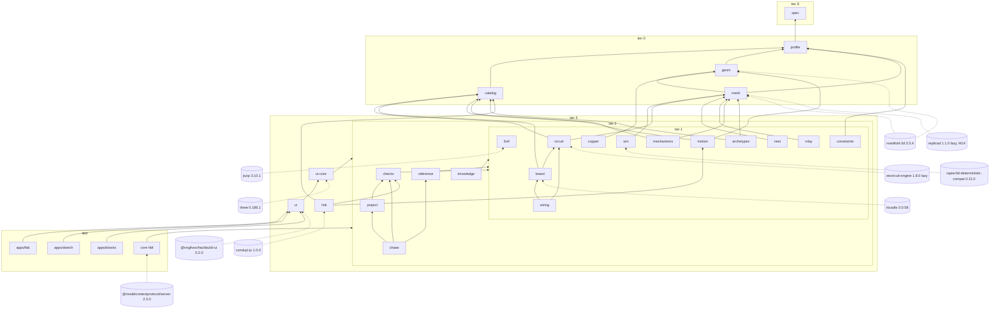

# Architecture

Version 4, 2026-10-04. Part of the hackbuild-fab plan set; PLAN.md is the index.

How packages, build pipeline, store, runtimes and registries fit
together. PLAN.md section 5 holds the decisions; this file holds the
detail a builder needs. Repo paths are relative to the hackbuild-fab
root; evidence paths are absolute.
Working names on first use: hbf (working name) for the binary, CHASE (working
name) for the design document, STYLUS (working name, was FEELER) for the
printed sensor design. PIP (was HAFT) is the published print-in-place
controller at hackbuild/pip-controller.

## 1. Thesis

A physical thing is a typed document whose features declare what must be
true, a deterministic build that makes geometry from it, and a check
registry that proves the declarations against the geometry. The model or
person writes `chase.ts` and `build.ts`. The kernel turns declarations into
Part IR in a fixed stage order. Checks read Part IR only and return
evidence with measured, legal, constraint and origin. Exporters run only
behind the gate. Every object lands in a content-addressed store, so two
builds with one hash are the same build.

## 2. Package graph

Packages sit in tiers and import downward only (D-044). Tiers S to 2 touch
no `document`, `window` or `vue` (D-045). The app layer is `core` (the hbf
binary with CLI, MCP and HTTP transports) and `apps/fab`, `apps/sketch`,
`apps/blocks` (D-143). External dependencies sit at the edges, each owned
by one package, with pins from D-040.



ASCII fallback for terminals and diff review:

```
app     core (hbf: cli/ mcp/ http/)      apps/fab  apps/sketch  apps/blocks
        | headless only, never ui         \________ ui ________/
tier 3  ui-core    ui    link             <- three, @virgilvox/hackbuild-ui, conduyt-js
tier 2  checks  project  reference  knowledge  chase (schema and validator only)
tier 1  3mf  sim  circuit  copper  board  nest  inlay  motion  wiring
        constraints  mechanisms  archetypes
        <- jszip, rapier deterministic-compat, eecircuit-engine (lazy), kicadts
tier 0  profile  catalog  geom  mesh      <- manifold-3d, replicad (lazy, M14)
tier S  spec (types, constants, define* helpers, jcs; zero runtime dependencies)
```

`@hackbuild/kernel` (`kernel/`) is the one published package; it
re-exports the headless tiers by subpath and never includes `ui-core`,
`ui` or `link` (D-036). Every directory under `packages/` is private.
tscircuit and circuit-json join `board` with exact pins at M08 (D-040). potrace, esm-potrace-wasm, kiutils and brepkit-wasm are
excluded on licence (D-043); LICENSING.md has the audit.

## 3. Import table

`tools/tiers.json` is the source; this table and every package README row
are generated from it (D-010). The CI `tiers` job parses each
`package.json` `dependencies` and fails on an edge the file does not list.

| tier | package | may import | external dependency |
|---|---|---|---|
| S | spec | nothing | none; types, constants, the define* helpers and `spec/jcs.ts` |
| 0 | profile | spec | none |
| 0 | catalog | spec, profile (pair added at M05) | none at runtime; KiCad and easyeda2kicad lookups on demand (D-103) |
| 0 | geom | spec, profile (pair added at M00-T01) | manifold-3d (CrossSection, D-163); earcut |
| 0 | mesh | spec, profile, geom (pairs added at M00-T01) | manifold-3d; replicad lazy for route `brep` (D-024) |
| 1 | 3mf | none (standalone, D-027); its input and result types are declared in packages/3mf/src/types.ts | jszip |
| 1 | sim | spec, profile, mesh | @dimforge/rapier3d-deterministic-compat |
| 1 | circuit | spec, profile, catalog, geom, mesh | eecircuit-engine, lazy (D-086) |
| 1 | copper | spec, profile, geom | none |
| 1 | board | spec, profile, catalog, circuit (pair added at M08) | kicadts; tscircuit and circuit-json at M08 |
| 1 | nest | spec, profile, geom, mesh | sparrow wasm under evaluation only (D-137) |
| 1 | inlay | spec, profile, geom, mesh | vtracer under evaluation at M03 (D-145) |
| 1 | motion | spec, profile, geom, catalog | none |
| 1 | wiring | spec, board, circuit (pairs added at M08) | none |
| 1 | constraints | spec, profile; never a kernel | none; kernels register into it |
| 1 | mechanisms | spec, profile, catalog, geom, mesh; no tier 1 package | none |
| 1 | archetypes | spec, profile, catalog, geom, mesh; no tier 1 package | none |
| 2 | checks | spec, tier 0, tier 1, read-only; never nest's DXF writer module | none |
| 2 | project | spec, tier 0, tier 1, checks (pair added at M04) | none |
| 2 | reference | spec, tier 0, tier 1; no tier 2 package | none |
| 2 | knowledge | spec, tier 0, tier 1 | none |
| 2 | chase | spec, tier 0, tier 1, checks, project, reference (pairs added at M10); schema and validator only | zod |
| 3 | ui-core | spec, tiers 0 to 2; no Vue | three |
| 3 | ui | ui-core (pair added at M09-T01) | vue, pinia, @virgilvox/hackbuild-ui; no three |
| 3 | link | spec, profile, catalog, motion, checks; never ui-core, ui or vue | conduyt-js |
| published | kernel | every package in tiers S to 2; never ui-core, ui or link | tsdown or tsc into `dist/` |
| app | core | every headless package and kernel; never ui-core, ui or link | @modelcontextprotocol/server, zod; view.render uses no external dependency (software rasterizer, node:zlib, D-209) |
| app | apps/fab, apps/sketch, apps/blocks | everything | none beyond the packages |

An edge passes when its target tier is strictly lower than its source tier
or when the pair is in `sameTier`. The twelve same-tier pairs (geom to
profile, mesh to profile, mesh to geom, catalog to profile, project to
checks, board to circuit, wiring to board, wiring to circuit, chase to
checks, chase to project, chase to reference, ui to ui-core) are the
complete list for M00 to M16, each added in the commit that writes the
import (PACKAGES.md 3.2). Everything else composes in `core`: circuit
never imports copper, mechanisms and archetypes import no tier 1 package,
nest and motion import neither each other nor sim, reference imports no
tier 2 package, and link imports no ui package.

`spec/jcs.ts` exports `canonicalize(value: unknown): string` (RFC 8785)
and `sha256Hex(data: string | Uint8Array): string`, both synchronous
TypeScript with no import, so node, the browser app and a `file://` bake
produce the same bytes. Every hash in section 8 is
`sha256Hex(canonicalize(x))` or `sha256Hex` over the bytes the row names.
profile, mesh, 3mf, nest, board, checks, project and core import these two
functions and no package defines its own (lint: no `createHash` or
`crypto.subtle.digest` outside `core/src/gate.ts`, which keeps
`node:crypto` for the HMAC of AGENT-SURFACE.md 6). The file lands at M-S,
where `mesh/src/hash.ts` first hashes. `spec/test/jcs.test.ts` holds the
RFC 8785 appendix vectors, `-0` written `0`, NaN and Infinity refused, and
the NIST sha256 vectors for the empty string and `abc` (D-051).

Shape of the file, so the generator and the CI job agree:

```json
{
  "tiers": { "S": ["spec"], "0": ["profile", "catalog", "geom", "mesh"] },
  "edges": { "board": ["spec", "profile", "catalog", "circuit"] },
  "sameTier": [["board", "circuit"], ["wiring", "board"]],
  "headless": ["S", "0", "1", "2"]
}
```

`edges` has one list per workspace, the full "may import" column above,
and the gate fails on an `@hackbuild` edge (package.json, `src/`, `seed/`
or `test/`) that the source's list does not name; the rank and `sameTier`
rule still runs as a second guard. `edgeExceptions` holds dated
`{source, targets, since, note}` entries for an edge the plan has not
reconciled yet: the gate reports them and fails once one is unused. On
2026-10-05 it holds 3mf to spec, profile and mesh, which M00-T01 step 3
and M00-T09 wrote against D-027 and PACKAGES.md 5.1, pending the owner.

The scaffold moves (catalog down to tier 0, renderer binding into
`ui-core`, constraints by inversion) are in PLAN.md section 5 and
section 7 below.

## 4. Data flow

```
 person or model
   | A  chase.patch on branch hbf/<chase>
   v
 chase.ts  +  build.ts
   | B  normalised params, defHash, paramsHash
   v
 build.ts(params, Author)
   | C  PartDraft or AssemblyDraft, profile reads, metrics, warnings
   v
 kernel stages 1 to 8 (per body, then per part)
   | D  Part IR with buildHash
   v
 check registry  <----- E  intervals, nearest, fix ----- constraints solver
   | F  CheckResult[] with reportHash
   v
 CommandResult  ---- G  evidence to the caller (CLI, MCP, HTTP, BenchHook)
   | H  export.run, only with no failing finding
   v
 gate (host ask, CLI TTY, HMAC requestState)
   | I  approved claim bound to buildHash
   v
 exporters (3MF, STL, DXF, SVG, gerbers, KiCad, Circuit JSON)
   | J  bytes plus artifactHash
   v
 <workspace>/.hbf/store, addressed as hbf://
```

| arrow | carries | decision |
|---|---|---|
| A | an anchored edit (anchor must match exactly once, else `E_STALE`) or a JSON pointer patch, written to `hbf/<chase>` | D-115 |
| B | the chase loaded through `defineChase`, migrated to schema 2, deep-normalised against defaults so no stored document yields NaN geometry; `defHash` over the canonical chase plus `build.ts` source bytes, never `bench.ts` (D-174); `paramsHash` over the normalised params | D-131, D-051 |
| C | bodies with a `ShapeDecl` per route, typed features with optional `body`, metrics and warnings; every `ProfileLookup` read is recorded and becomes `profileHash` | D-047, D-048, D-049 |
| D | `Part`: bodies, solid as their union, features, frame, metrics, warnings, `buildHash`; meshes as `hbf://mesh/<meshHash>` | D-048, D-051 |
| E | `Interval` per constraint dim with every floor and ceiling naming kernel and reason; `legal` null on `E_UNSAT`; `nearest` becomes `Fix.set` | D-064, D-072 |
| F | `CheckResult {id, version, verdict, severity, target, measured, legal, constraint, origin, fix?, extra?}`; missing or NaN measured is `E_PARAM_MISSING` | D-064, D-067 |
| G | `CommandResult`: ok, verdict, stage, result, buildHash, inputsHash, findings, counts, errors, artifacts, truncated, next; summary detail capped at 5,000 tokens with a cursor | D-064, D-110 |
| H | the build hash and findings; a fail verdict stops here and the gate is never shown | D-109 |
| I | a claim `{cmd, argsDigest, buildHash, exp, nonce}` with a 10-minute expiry and single-use nonce; a moved build hash re-asks | D-109 |
| J | export bytes per `ExporterDef`; `inferred` catalog parts refuse with `E_PROVENANCE` (exit 4) | D-052, D-102 |

Before stage 1, `part.build` runs one draft pass: every `chase.applied`
entry for a part calls its archetype's `apply()` on the PartDraft and the
returned bodies and features are appended, with local slots mapped onto
`chase.materials` and ids prefixed `<archetype id>.<applied index>.`
(D-165, spec/build.ts `APPLIED_MERGE`). The stage order itself is
unchanged.

The kernel stage order, fixed so chamfer after union cannot be expressed
(D-047):

| stage | runs | reason it is fixed |
|---|---|---|
| 1 base | each body's `ShapeDecl` through its mesh route | routes declare guarantees (manifold, exact Z, per-slot disjoint), D-053 |
| 2 pre-union cutters | `chamfer`, `round` on base edges | half-spaces are unbounded; after union they cut neighbours (CHK-SHP-01) |
| 3 union positives | `boss`, `web`, generator positives | batch union, verify `is_volume`, then fold (D-055) |
| 4 post-union cutters | `bore`, `pocket`, `window`, `screw`, generator cutters | cutters see the final positive volume |
| 5 partition | role priority flex-conductor, flex, conductor, art, body, then declaration order | PIP partition order, so 3MF parts never overlap |
| 6 insets | coincidence inset 1 um by edge normal, pinch inset 0.02 mm Miter | the two CHK-3MF-04 parameters (D-070) |
| 7 frame emit | frame rules, pose with volume parity, `mirrorOnFlip` | D-063 |
| 8 hash | `meshHash` per body, solid as union, then `buildHash` | D-051 |

A generator emits `GeneratedGeometry {preUnionCutters, positives,
postUnionCutters, bodies}` (bodies required) holding `ShapeDecl`
declarations, never meshes. It is pure: no I/O, no store, no wasm. It
reads `KernelCtx` (profile, route, process, `machineView`, the host
`body` and the declared `faces`). The kernel meshes the declarations at
stages 2 to 5, and `MeshRef` is assigned only at stages 7 and 8 (D-206).
Only `chamfer` and `round` may populate `preUnionCutters`. Vertices snap to a dyadic 1/1024 mm grid before stage 8
(D-054). An assembly is what `build.ts` returns for a composer chase;
`asm.solve` reads it, and bought bodies (servos, boards, displays) carry
body and flange envelopes (D-104).

## 5. Runtime contexts

The same headless code runs in four places. What changes is how wasm loads,
whether work leaves the main thread, and where the store lives.

| context | entry | wasm loading | threads | storage | gate |
|---|---|---|---|---|---|
| node CLI | `core/bin/hbf.mjs` | from `node_modules` through package imports | main thread | `<workspace>/.hbf/store/` on disk | export needs a TTY; no bypass flag; no standing env token |
| MCP server | `hbf mcp`, `@modelcontextprotocol/server` 2.3.0, protocol 2026-07-28 | as node CLI | as node CLI; long work runs as a task (`io.modelcontextprotocol/tasks`) | the same on-disk store; the server holds no state between requests | MRTR `input_required` with HMAC `requestState`; `E_GATE_UNAVAILABLE` without elicitation |
| browser app | `apps/fab`, `apps/sketch`, `apps/blocks` over http(s) | ESM imports bundled by vite 8.3.2 | kernels are thread-agnostic; the app picks worker or main thread by feature detection (badge-replicator pattern) | in-memory map keyed by the same `hbf://` URIs; `localStorage` keys prefixed `hbf.` in try/catch for shell state only (D-123) | PRINT or MAKE runs checks first; consequential device actions use link arming |
| `file://` bake | one HTML file per design (D-129) | manifold as a classic script with base64 wasm (PIP `vendor/manifold-classic.js`, COTTER `build.py`); three 0.186.1 inlined as a module script (D-127) | main thread only; no blob or module Workers under `file://` | in-memory map keyed by the same URIs; share link in `location.hash` (D-125) | export runs checks; the file writes nothing outside the download |

Rules that follow from the table:

- A bake is at most 16 MB, makes zero network requests at load and
  reproduces its sha256 on a cold rebuild (D-129). Assets come from a
  per-design manifest; ordering by file name (PIP `build.sh`) is retired.
- eecircuit-engine is a 19 MB ESM file in a 43 MB package (vendor, npm
  listing, verified-claims C9) and replicad's kernel is 48.9 MB (vendor,
  D-024), so neither fits the 16 MB bake. The offline bake carries the
  analytic DC solve only (D-086), and the BRep route never enters a
  default bake.
- `CommandCtx.workspace` comes from server configuration, never from a
  model argument. `CommandCtx.signal` is an `AbortSignal`, and manifold
  `ExecutionContext.cancel()` hangs off it so a slider drag cancels a
  stale rebuild; the cancelled scope still frees its objects (D-055).
  On stdio the server logs to stderr only.
- Python under `tools/py/` (uv, numpy declared) runs in CI and local
  validation only; a Python tool is ported at proven parity, never
  deleted before (D-140).
- `BenchHook` exposes the same strings in a bake as the CLI prints, so
  `hbf://` URIs resolve inside a bake against its in-memory map (D-128).
- In the node CLI, the MCP server and the HTTP endpoint the FAB app calls,
  `build.ts` runs in a child node process under the build sandbox
  (section 11.2, D-178), never in the process holding the store and the
  gate key. A bake carries no TypeScript: `chase.bake` embeds the chase as
  JSON and bundles `build.ts` with the pinned vite 8.3.2, and the page
  runs on the main thread as the table states.

## 6. Addressing and the store

`hbf://` URIs point into `<workspace>/.hbf/store/`, keyed by content hash
for builds, meshes, reports and artifacts, plus static resources (D-050).
MCP 2026-07-28 removed sessions, so state crosses calls as server-minted
handles passed as ordinary arguments.

| uri | resolves to | retention |
|---|---|---|
| `hbf://chase/<id>` | the chase on the current branch | live |
| `hbf://build/<buildHash>` | the build record: Part IR, metrics, warnings, BuildInputs | until `hbf gc`; default keeps the last 50 builds per chase |
| `hbf://build/<buildHash>/part/<partId>` | one part | as its build |
| `hbf://mesh/<meshHash>` | binary mesh `.hbfm`: ASCII `HBFM`, uint32 version 1, uint32 vertexCount, uint32 triangleCount, then little-endian float32 xyz, then uint32 indices (milestones/M00-foundation.md M00-T04 step 6) | while a kept build references it |
| `hbf://report/<reportHash>` | a check report | as its build |
| `hbf://artifact/<hash>` | an export or a PNG | as its build |
| `hbf://check/<id>` | check definition, origin record, legal-value derivation | static, `cacheScope: public` |
| `hbf://feature-kind/<kind>` | schema, generator stages, checks, fit class, reference ids | static |
| `hbf://archetype/<id>`, `hbf://mechanism/<id>` | canon entry with `derive()` source | static |
| `hbf://reference/<id>` | chase, build.ts, expected/ | static |
| `hbf://profile/material/<id>`, `/machine/<id>`, `/fit/<class>` | profile row with provenance | per profile hash |
| `hbf://knowledge/<record>` | one knowledge record | static |
| `hbf://project/graph` | items, links, stale list | live |

Source: `fab-knowledge:synthesis/api-library-ai-design.md` 7.1.

A command taking `part`, `build`, `assembly` or `target` accepts a chase id
(build now, or reuse the cached build with equal inputs) or one of these
URIs. An unknown or collected URI returns `E_HANDLE` naming the chase it
came from.

```
<workspace>/.hbf/
  store/builds/<buildHash>.json
  store/meshes/<meshHash>.hbfm
  store/reports/<reportHash>.json
  store/artifacts/<hash>.<ext>
  calls.jsonl          loop detection (D-111)
  gate.key             HMAC key, 32 random bytes, mode 0600, never committed
  gate-used.jsonl      spent gate nonces (D-109)
  gate-used.lock       O_CREAT|O_EXCL lock NonceLedger.consume() takes, so one state is spent once across a stdio and an --http server (M12-T04, D-206)
```

`.hbf/` is in `.gitignore`. Builds reproduce from inputs, so the store is a
cache with evidence and never a source of truth. `calls.jsonl` is keyed on
workspace and branch: the same command and `inputsHash` three times in 30
minutes, or four failing builds with one `reportHash`, returns `E_REPEAT`
naming a diagnostics record (D-111).

## 7. Registries

Extension is a registry entry, never new syntax and never a switch on kind
outside its registry. Eleven registry kinds, one manifest format (R89 drops
`kinds`, since the six chase kinds are fixed by D-126).

| RegistryKind | def type (spec file) | registered by | example ids |
|---|---|---|---|
| featureKinds | `FeatureKindDef` (feature-kinds.ts) | the kernel that generates the kind | `bore`, `spring`, `inlay` |
| checks | `CheckDef` (checks.ts) | checks (`src/defs/<family>/`, with `src/defs/3MF/` over the 3mf rule functions), inlay (CHK-INL-01 to 04) | `CHK-3MF-06`, `CHK-KEY-04` |
| constraints | `ConstraintDef` (constraints.ts) | kernels and canons, by inversion | `conductor.width`, `detent.freeLen` |
| exporters | `ExporterDef` with `fabrication` flag (registry.ts) | writers in 3mf (3mf, stl, card), nest, copper, board, wiring; png from core view.render; `ExporterDef` bindings in `core/src/exporters/*.ts` | `3mf`, `stl`, `dxf`, `gerbers` |
| simModels | sim model defs (sim.ts) | sim | snap FE, granular trials |
| panels | `PanelRef` registry string (chase.ts) | ui | drive pad, notes panel (D-124) |
| adapters | exporter dialects and importers | 3mf (`3mf/bbs-01.10.01.50` dialect adapter named in BuildInputs), catalog (KiCad, easyeda2kicad lookups) | `3mf/bbs-01.10.01.50` |
| profiles | material, machine, fit band rows (profile.ts) | profile, written through coupons by a person | `ffc5p`, `petg`, `PSLIP` |
| motion | planners and programs | motion | merged DETENT and WASHER planners (D-139) |
| mechanisms | `MechanismDef` with `derive()` (canon.ts) | mechanisms | count-wheel detent, Geneva |
| archetypes | `ArchetypeDef` with `derive()` and `apply()` (canon.ts) | archetypes | BLOCKS stud, PIP buttons |

The types live in `spec/registry.ts` (REGISTRY_KINDS, RegistryKind,
DefFor, Manifest, RegistryEntry, Registry); this file links them and does
not copy the bodies (D-179). `Registry` carries `get` and `list` for
`hash()`, manifests and tooling, and three typed lookups that are the
dispatch path: `featureKind<K>(kind)`, `checksFor<L>(level)` and
`check(id)`. Kernels and check runners dispatch through those three and
never through `get("featureKinds")` or `get("checks")`; the one correlated
cast lives in `core/src/registry.ts` (D-206).

Registration by inversion: `constraints` imports spec and profile and
nothing else. Each kernel and canon package exports a manifest of
`ConstraintDef` entries (dims, the bound function, the kernel id and
reason), and the registry loads them at startup. The solver walks
registered defs for a dim; it never imports `mechanisms`, `archetypes` or
`circuit`. That is how `conductor.width` gets its resistance floor from
`circuit` (3.23 mm at 30 ohm cm, 62 mm, 0.72 mm, 8 kohm, computed, D-072)
without a tier 1 cycle.

Load-time rules: an id registered twice fails startup; a `requires` entry
naming an absent id fails startup with `E_REF`; one `KernelId` union serves
`CheckDef.needs`, `Bound.kernel`, `ChaseMeta.kernels` and `tools.json`
(D-057). `registryHash` covers the resolved version of every entry a build
used.

## 8. Hashes and BuildInputs

All hashed inputs are canonical JSON per RFC 8785 (D-051), produced by
`spec/jcs.ts` (section 3).

| hash | over | decision |
|---|---|---|
| defHash | canonical chase plus the source bytes of `build.ts` and its relative imports, each named by its forward-slash path relative to the design directory and sorted by it, so moving or renaming a design keeps its defHash; `bench.ts` excluded | D-051, D-174, D-178 |
| paramsHash | canonical params after deep normalise | D-051, D-131 |
| profileHash | the profile rows the build read, tracked by `ProfileLookup` | D-051 |
| registryHash | resolved versions of feature kinds, constraint defs, checks, exporters used | D-051 |
| buildHash | canonical `BuildInputs` | D-051 |
| meshHash | int32 `round(v * 1024)` after the 1/1024 snap, sorted vertices, each triangle rotated to its smallest index with winding kept, sorted triangles (AGENT-SURFACE.md 7.3) | D-051, D-175 |
| reportHash | findings sorted by id, then target, then the canonical JSON of the hashed finding (a total order), without timing, with resolved check versions | D-064, D-243 |
| artifactHash | per export; for 3MF, sha256 over sorted (entry name, sha256 of uncompressed bytes) with date metadata normalised | D-052 |
| snapshotHash | deterministic Rapier state; enters BuildInputs only after D-134 | D-056, D-134 |

```ts
export interface BuildInputs {
  defHash: Hash;
  paramsHash: Hash;
  profileHash: Hash;
  registryHash: Hash;
  kernelVersion: string;                 // @hackbuild/kernel version
  engines: { manifold: string; rapier?: string; ngspice?: string };
  adapter: string;                       // exporter dialect, "3mf/bbs-01.10.01.50"
  seed: number;                          // every stochastic step (nesting, trials)
  sourceDateEpoch: number;               // seconds; injected into every writer, never Date.now()
  licences: Record<string, string>;      // kernel and dependency SPDX ids (D-041)
}
```

`profileHash` exists because a coupon that writes kerf back changes
geometry and must change the hash. `engines.manifold` is there because
manifold-3d 3.5.0 introduced cross-platform deterministic doubles
(verified-claims C8, correction C-11); earlier versions can give
different meshes on different machines.

## 9. Determinism

| rule | how | decision |
|---|---|---|
| mesh hashes equal across machines | CI builds every reference on ubuntu x64 and ubuntu arm64 and compares `meshHash` | D-056 |
| no clock in any output | writers read `sourceDateEpoch`; `SOURCE_DATE_EPOCH` sets it in CI | D-051, D-052 |
| reproducible 3MF bytes per writer | fixed CreationDate and ModificationDate, fixed UTC zip mtimes, no directory entries, sorted entries, fixed deflate level | D-052, C-08 |
| js and py writers agree | equal entry contents and equal artifactHash; byte identity across the two writers is outside the requirement | D-052 |
| seeded randomness | `seed` in BuildInputs; nesting and trials take it; SLUG's runner is rebuilt seeded before its M02 target | D-136 |
| sim snapshots | `@dimforge/rapier3d-deterministic-compat` 0.21.0; snapshot hashes enter BuildInputs after M02 measures the 30-trial runtime | D-134 |
| bake bytes | deterministic sha256 on a cold rebuild | D-129 |
| coplanarity | dyadic 1/1024 mm snap, exact in float64 and in float32 STL | D-054 |

C-08 evidence: one input gave py 3979 B and js 4243 B (measured); JSZip
adds `3D/`, `Metadata/` and `_rels/` directory entries; two py runs 2 s
apart differ; the date stamps sit at `orca3mf.js` lines 91 and 247 and
`orca3mf.py` lines 193 and 384. The js writer therefore sets each JSZip
entry's date from `sourceDateEpoch` and suppresses folder entries; the py
writer builds `ZipInfo` with a fixed `date_time`. A hash over sorted entry
contents (artifactHash) is the comparison when bytes cannot match.

## 10. wasm boundaries and memory

| engine | package | loaded | freed by |
|---|---|---|---|
| manifold-3d 3.5.4 | geom, mesh | eagerly in every context | the scope that created the object (D-055) |
| rapier3d-deterministic-compat 0.21.0 | sim | on first sim command | the sim run that created the world |
| eecircuit-engine 1.8.0 (ngspice 45.2) | circuit | lazy, for device models and transients only | the solve that started it |
| replicad 1.1.0 (OpenCascade, LGPL-2.1-only) | mesh, route `brep` | lazy, M14, never in the default bake | the route call |
| sparrow (self-built wasm) | nest | evaluation only (D-137) | the pack call |

Ownership rules (D-055):

- Scope-based ownership after COTTER `GEO.scope`: every manifold object a
  scope creates is deleted when the scope closes, unless the scope returns
  it to its caller, which then owns it.
- A live-object counter after PIP's `liveCount()` runs in tests; the count
  is asserted zero after every sweep (M00 target: zero after a 100-design
  sweep).
- No wasm handle crosses a package boundary or enters Part IR. Part IR
  holds `hbf://mesh/<meshHash>` references and plain typed arrays, so
  checks never own engine memory.
- Union tries a batch, verifies `is_volume`, then folds pairwise (PINTLE:
  batch fails on coplanar faces, pairwise fold fails on shared edges).
- A vertex nudge exceeds the downstream weld; a 0.2 um CASK nudge under a
  1e-4 weld recreated non-manifold edges (D-054).
- CASK v0.3 preview-CSG exports had 14109 (shell) and 14108 (cap) edges
  used other than twice (measured); the v0.4 Manifold path exports
  `newcask_shell` and `newcask_cap` with 0 (measured). That failure is why
  every export replays through Manifold. Evidence:
  `fab-knowledge:evidence/x/downloads/dl-cases/cask/cask_shell.stl`,
  `fab-knowledge:evidence/x/downloads/dl-cases/cask/cask_cap.stl`,
  `fab-knowledge:evidence/x/downloads/dl-cases/cask/newcask_shell (1).stl`,
  `fab-knowledge:evidence/x/downloads/dl-cases/cask/newcask_cap (3).stl`.

## 11. Trust boundary

Two sides. Offline generators (tiers S to 2, core, every bake) read
declarations and write geometry, reports and files. Live instruments
(`link`, tier 3) move machines, fire lasers, heat beds and cut vinyl. No
package below tier 3 holds a transport, and `core` never imports `link`.

| boundary | rule | decision |
|---|---|---|
| model to outside files | fabrication exports pass the host gate; failing builds are never offered | D-109 |
| inferred data to fabrication | `inferred` catalog parts and unprovenanced numbers refuse with `E_PROVENANCE` | D-102 |
| model to profile | no model enters a coupon or measured result or raises a tier; a model adds a row only at vendor, community or inferred tier with its source, in the card that names it | D-082, D-099 |
| page to device | capability vocabulary: observe (`mesh.3d`, `sheet.2d`, `circuit.netlist`, `print.3mf`, `cut.svg`, `render`, `check`) and consequential (`send.print`, `fire.laser`, `heat.bed`, `cut.vinyl`); consequential capabilities arm per device per session with one informational confirm | D-161 |
| driver internals | duty limits in the lowest driver; remote input clamped; config authority `(value, rev, origin)`; CLASP SNAPSHOT replay never executed; arm confirmed by telemetry; stop on unload | D-093 |
| conduyt | conduyt-js 1.0.0 wrapped as one driver behind the same contract | D-093 |
| CLASP payload | JPEG check at 65439 (65535 minus 96, LOUVER) or 65535 minus the encoded PUBLISH overhead for the actual address | D-093, C-17 |
| GPL drivers | the rtl-sdr driver stays in hackbuild-bench (owner, default) | D-094 |
| secrets | keys typed into a bench stay in that browser, shown as first 4 and last 4, never logged | D-009 |
| bench origin | bakes never serve from the signed-in `.hack.build` cookie origin; release assets and hackbuild-fab Pages until a cookieless origin exists (owner, default) | D-034 |

The driver contract, transports, capability vocabulary and sim twins come
out of hackbuild-bench at M13 (`src/core/capabilities.ts`,
`src/core/drivers/types.ts`, `src/core/bus/DeviceBus.ts`, digest in
`fab-knowledge:sources/repos/hackbuild-bench-and-ui.md`).
A driver writing a browser device API directly, outside a shared transport,
is a bug.

### 11.1 Trust boundaries for untrusted input

Files and links from outside the opened workspace cross a third boundary
on their way into the kernels (D-166). Each reader enforces its rule before
any kernel sees the bytes and returns E_SCHEMA naming the rule and the
limit. The limits are plan budgets (inferred); raising one takes a new
decision entry.

| input | reader | rule | decision |
|---|---|---|---|
| 3MF and any zip | `packages/3mf` reader, `tools/py/validate_3mf.py`, harvester | reject entry names with a `..` segment, a leading `/` or `\`, or a drive letter; at most 4096 entries; total inflated size at most 256 MB, counted while inflating | D-166 |
| share link `#d=<meta.chase>.<base64url>` | `packages/ui-core/src/bench/share.ts` | inflated payload at most 1 MB; version read, `packages/chase` migrate from it, deep normalise, zod validation, then `loadDesign`; no prefix routes through `migrate/legacy.ts` | D-166, D-167 |
| design JSON | drop, file picker, `loadDesign` | 1 MB cap and the same validation; document text renders as text, never as HTML | D-166 |
| OpenSCAD source | mesh `imported` route | only a file the user named; `openscad` with a 60 s timeout in a fresh temp directory holding a copy, `OPENSCADPATH` set to it; pre-scan refuses absolute or `..` paths in `include`, `use`, `import`, `surface` | D-146, D-166 |
| SVG art | inlay intake, geom `fillPath` layers | refuse a DOCTYPE; strip `script`, `foreignObject`, `on*` attributes and every `href` not starting with `#` before parse | D-166 |
| raster art | inlay intake | at most 8192 px per side | D-166 |
| meshes | STL, GLB, WRL; STEP at M14 | file at most 256 MB; winding checked | D-102, D-166 |
| `chase.ts`, `build.ts` | node CLI, MCP server, bake | code from the opened workspace only; no module named by a document or link is fetched or evaluated; `chase.ts` read as a literal and never executed, `build.ts` run only in the sandbox of 11.2 | D-166, D-178 |

The fuzz job in TESTING.md section 4.2 drives the 3MF reader and the share
decoder through these rules from M00. RISKS.md R-25 tracks the risk.

### 11.2 Reading a chase, running a build

A workspace holds files the person running hbf did not write: references,
a design copied from someone else, the items a `catalog` chase lists. The
loader treats the two design files differently (D-178).

`chase.ts` is data. `packages/chase/src/source.ts` parses one `export
const chase = defineChase({...})` over a literal object (strings,
numbers, booleans, null, arrays, objects, `as const`; no identifier
values, calls, spreads, computed keys or template substitutions), then
applies the derived zod schema, migrate and deep normalise (D-131). It
imports nothing, evaluates nothing and needs no TypeScript compiler, so
it runs the same in node and in the browser. `chase.validate`,
`chase.diff`, `chase.patch`, the FAB app and `part.build` all read the
chase this way. `chase.patch` edits through the reader's byte spans and
reparses before writing (AGENT-SURFACE.md 3.7). The rules are
`CHASE_SOURCE_RULES` in spec/chase.ts; a breach is E_SCHEMA with
`record` `chase-source/<rule>`.

`build.ts` is code. It runs in a child node process:

```
parent (core: store, gate key, .hbf/)            child (one per design bundle hash)
  params, profile snapshot, presets  --IPC-->   node --permission, env {}
                                                  --allow-fs-read=<design dir>,<kernel dirs>
                                                  --max-old-space-size=2048
                                                  preload: resolve hook (allowlist),
                                                  fetch, WebSocket, EventSource,
                                                  process.binding removed
  validate draft schema  <--IPC--  BuildResult, profile read log
  kernel stages 1 to 8 (D-047)
```

No write access, child processes, workers, addons or WASI; imports
limited to `@hackbuild/kernel/author`, `@hackbuild/spec` and relative
files inside the design directory; 30000 ms wall budget then SIGKILL
(inferred plan budget). The child holds no store handle, so a build can
return only a draft, and the parent refuses any draft the schema refuses
before kernel stage 1. Node 22.18 strips erasable TypeScript types
without a flag (vendor; confirmed at M00), so no transpile step sits
between the file and the child. Reasons a build stops are
`BUILD_SANDBOX_REASONS` in spec/build.ts, each E_KERNEL with `record`
`build-sandbox/<reason>`.

The child inherits no environment variable (spawned with `env {}`,
`NODE_OPTIONS` included, and `execArgv` limited to the permission and heap
flags), so a build cannot read tokens from `process.env`. Node documents
its permission model as a guard for trusted code with no guarantee against
malicious code. The sandbox limits what an honest or careless `build.ts`
can do and is no security boundary against a hostile one; a `build.ts`
from a source the person does not trust is reviewed before it runs.

The bake differs because `file://` allows no module or blob Workers
(D-129). `chase.bake` embeds the reader's JSON and bundles `build.ts`
with the pinned vite 8.3.2 under the same allowlist, so the page holds
JavaScript its baker built and nothing later turns data into code: share
links and dropped design JSON are data under D-166 and D-167.

`core/test/build-sandbox.test.ts` proves that a `build.ts` calling
`fetch`, importing `node:fs` to call `writeFile` (static and dynamic
import), importing `node:child_process` or `../outside.ts`, spinning
forever, or returning NaN stops with the named reason and writes
nothing, and that a `build.ts` putting `process.env.NPM_TOKEN` into a part
name, with `NPM_TOKEN` set in the parent, yields a draft where that value
is absent; `packages/chase/test/source.test.ts` proves each source rule
and that the reader's value equals the module's default export for every
reference. Both land with `part.build` at M00; span patching lands with
`chase.patch` at M10.

## 12. Extension points

Each row lists the files a contributor touches. Generated files (INDEX,
reference pages, `llms.txt`, counts) are never edited by hand (D-010).
Every addition lands with its reference in the same milestone (D-105).

| add a | files touched | gate that proves it |
|---|---|---|
| feature kind | `spec/features.ts` (interface, union member, camelCase name); `packages/<kernel>/src/kinds/<kind>.ts` (`FeatureKindDef` with generate, non-empty checks, fit or `"none"`, non-empty reference, schema, version); `packages/<kernel>/src/manifest.ts` (featureKinds and its `ConstraintDef` dims); at least one check (row below); `reference/<area>/<id>/` | `tsc` refuses a def without checks or reference (D-058); coverage test (M11) |
| check | `packages/checks/src/<family>/<CHK-ID>.ts` (`CheckDef` with version, needs as `KernelId`, target, legal kind, `drivenBy`, origin record); `knowledge/` record the origin cites; a known-bad fixture | message-number golden; origin test; seed conformance (D-066) |
| exporter | `packages/<kernel>/src/exporters/<id>.ts` (`ExporterDef`, `fabrication` flag set when it writes something a machine makes); `tools/corpus/<kind>/` pass and known-bad fixtures; `EXPORT_ALIASES` in `spec/hook.ts` only for a legacy name | corpus job; determinism under `SOURCE_DATE_EPOCH`; gate tests if fabrication |
| archetype | `packages/archetypes/src/<id>.ts` (`ArchetypeDef` with `derive()` and `apply()`, tier, provenance; resistances computed at load from profile, D-098); `reference/<area>/<id>/` | `arch.apply` on a fresh prism with every conductor check unchanged (M06) |
| mechanism | `packages/mechanisms/src/<id>.ts` (`MechanismDef` with typed `derive()`; stub marked when no equation); goldens with the D-096 corrected numbers where they apply | `mech.derive` goldens |
| panel | `packages/ui/src/panels/<id>.vue`; the ui panels manifest; `requires` capabilities from D-161; generic primitives go upstream to @virgilvox/hackbuild-ui (D-116) | BenchHook conformance and smoke at 390, 768, 1280 px |
| slot | `designs/<id>/chase.ts` `slots` entry naming a component for `rail.before`, `rail.after-params`, `stage.overlay` or `status.extra`; the component under `designs/<id>/` | the six kinds stay fixed (D-126); a seventh needs a measured layout sharing nothing |

A new mesh route, registry kind or chase kind needs a decision entry first.

Detail elsewhere: PACKAGES.md (per package), CHECKS.md (check registry),
AGENT-SURFACE.md (commands, gate, error codes), UI.md (BenchHook, bake),
TESTING.md (determinism job, corpus), LICENSING.md, and `spec/`.

Decides: D-024, D-034, D-036, D-040, D-043, D-044, D-045, D-047, D-048, D-049, D-050, D-051, D-052, D-053, D-054, D-055, D-056, D-057, D-058, D-063, D-064, D-086, D-093, D-102, D-105, D-109, D-111, D-115, D-123, D-126, D-127, D-128, D-129, D-131, D-134, D-136, D-137, D-140, D-143, D-161, D-163, D-165, D-166, D-167, D-178
