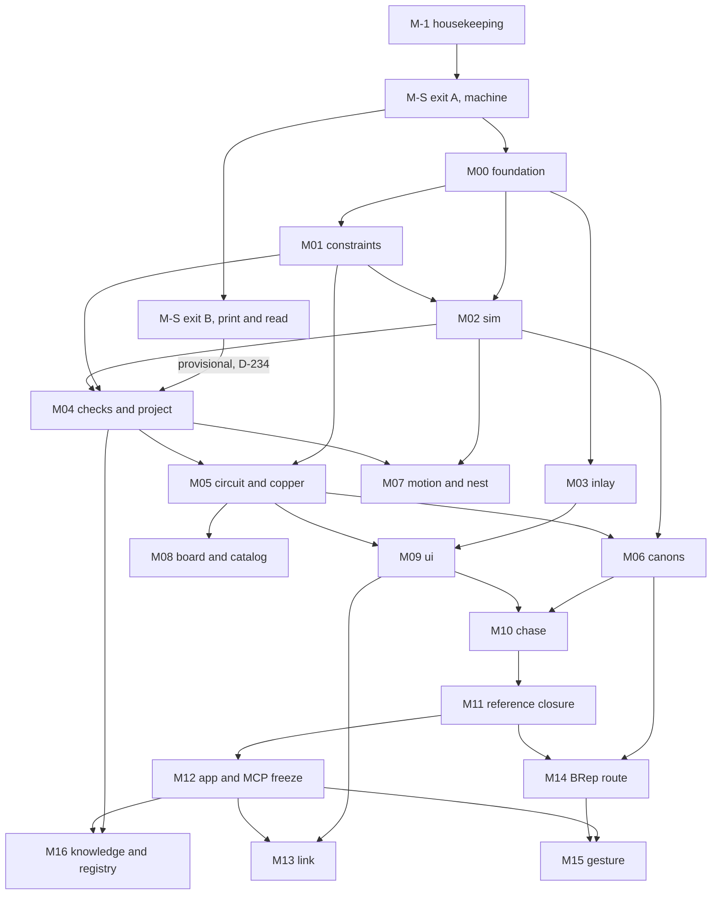

# Milestones

Version 5, 2026-10-08 (D-232, D-233 and D-234 written into Parts 1 and 4). Part of the hackbuild-fab plan set; PLAN.md is the index.

This file is the milestone index and the rules every milestone card follows.
PLAN.md section 21 states the decision (D-157); the cards live in
`milestones/`, one file per milestone. A builder with no other context reads
Part 1 to find the current milestone, Part 2 to read its cards, Part 3 for the
rules that make a milestone green, and Part 4 for what must land first.

M-S, the walking skeleton, sits between M-1 and M00 (D-179). It runs one
reference, keys flex-pair, from chase.ts to a print read on a Pico before
any contract is frozen. Until a milestone runs a spec file, that file is
draft (1.5).

hbf (working name) is the binary with CLI, MCP and HTTP transports. CHASE
(working name) is the typed design document. STYLUS (working name, was
FEELER) is the printed sensor design. PIP (was HAFT) is the published
print-in-place controller at hackbuild/pip-controller. Working names stay
flagged in the first PR body per D-012.

Every number below carries a qualifier (measured, computed, vendor, inferred,
unknown) or names the file it was counted from (D-007). Counts of seeds,
checks and tools are as of 2026-10-04; generated by tools/counts.mjs from M-1
onward (D-010). Repo paths are relative to the hackbuild-fab root; evidence
paths are absolute.

Evidence roots used in this file and every card:

| short | absolute path |
|---|---|
| v3 | `fab-knowledge:evidence/x/plan-to-refine/` |
| hbf | `fab-knowledge:evidence/x/plan-to-refine/handoff/hbf/` |
| x | `fab-knowledge:evidence/x/` |
| syn | `fab-knowledge:synthesis/` |
| corpus | `fab-work-directory:` |
| repos | `hackbuild/` |

Short names expand by plain prefix: `x/pip-controller/src/snapfe.js` means
`fab-knowledge:evidence/x/pip-controller/src/snapfe.js`.
Cards write evidence paths in full.

---

## Part 1. Milestone index

### 1.1 The table

One row per milestone. "Exit numbers" are the targets the card files turn
into acceptance commands. "Release at exit" names what ships when the row
goes green; "none" means nothing leaves the repo.

| id | name | packages | goal | exit numbers | depends on | release at exit |
|---|---|---|---|---|---|---|
| M-1 | housekeeping | spec, tools, .githooks, .claude, .github, registry, docs/plan; seeds into packages/*/seed and tools/py | Repo with rules, enforcement, spec and corrected seeds before any geometry code. | commit-msg test: 14 messages, 4 pass, 10 reject; `tsc -p spec/tsconfig.json` exit 0; seed conformance: 85 checks (76 block, 9 warn), 14 empty `what` filled, every origin.date set, 24 mechanisms, 29 archetypes; template diff report: 37 missing, 7 extra keys (counted against the gold file); healer: fixture B converges with 4 frozen cells and fixture C reports 2 ill-formed windows, fixture A (2137 cells, computed, watertight, 0 non-manifold vertices) is a non-regression guard; registry/tools.json holds 59 tools; derived job clean | none | none; the first push happens when the owner asks (D-006) |
| M-S | walking skeleton | thin slices of profile, mesh, circuit, checks, 3mf, core; reference/keys/flex-pair | keys flex-pair goes from chase.ts to build.ts, Part IR, six checks and a 3MF, is printed on ffc5p and read on a Pico, and only then are the contracts it ran frozen. | exit A (machine): realGap(0.275, 'hole', 'ffc5p', 'petg') = 0.075 per side (computed, D-207); layer tops 0.73, 1.45, 2.41 mm (computed; snapped 0.73046875, 1.4501953125, 2.41015625 in the mesh, D-208); one meshHash and one buildHash on two runs; key trace 74.4 kohm and GND bus 148.8 kohm at 500 ohm cm (computed, inferred row); six checks run at defaults with no fail (D-223): CHK-PRT-04 skip (8.39 mm infill wall, D-198, computed), CHK-NET-02 (0.7559 mm bus to the K1 column half, legal at least 0.60, computed), CHK-NET-29 warn (295.31 kohm path, inferred rows), CHK-KEY-01 (1.84 mm, legal 1.632 to 2.04 against the built 4.08 mm cone, computed), CHK-3MF-06 and CHK-3MF-07 pass; gap 1.0 fails CHK-KEY-01 with fix 1.64 (1.632 rounded up to the 0.02 param step, computed); `validate_3mf.py --overlap` (seed validator) exit 0; equal sha256 on two exports. exit B (physical): Flash Studio opens the file with four filaments on slots 1 to 4 (D-223); each key reads pressed 50 of 50 and released 50 of 50 on a Pico, or the failure is recorded (measured); every finding resolved by a decision entry; the files M-S ran are frozen | M-1 | none |
| M00 | foundation | profile, geom, mesh, 3mf, core (hbf CLI skeleton), tools/py | profile, geom, mesh and 3mf at parity; hbf CLI skeleton with the error contract; hackbuild-3mf extracted. | realGap(0.275, 'hole', 'ffc5p', 'petg') = 0.075 per side to 6 digits (computed); COLLAR offsets match to 1e-6 mm; mesh live count 0 after a 100-design sweep; gold round trip passes `--roundtrip`; known-bad 5 of 5 fail with the named check; 21 of 21 BOSS 3MFs pass `--overlap`; 25 owner 3MFs parse (24 on the 0.4 preset, hsl.3mf on 0.25); COLLAR key set equals the 127 gold keys; per-part volumes within 1e-3 mm3 of legacy; demo coin prints `parts 5473.667 vs solid 5473.667 mm3` (computed); SPRUE geometry parity (SPRUE writes 21 per-filament keys); two writer runs with one SOURCE_DATE_EPOCH give equal sha256; py and js artifactHash equal; x64 and arm64 meshHash equal | M-S exit A | hackbuild-3mf 0.1.0 on npm and PyPI from one tag after D-037 (D-027) |
| M01 | constraints | constraints, sim (fe), profile | Generate from legal. | flat-arch stiffness 0.585396 vs theory 0.585394 N/mm within 2e-6 (computed); PIP defaults give 2.527 N at 0.629 mm, drop 76.5 percent, contact 1.369 mm, eStop 2.31 percent (computed); l 22 t 0.5 gives 2.282 N, 1.245 mm (computed); Q sweep: no snap 1.0 and 1.1, snap from 1.2 (drop 0.01), drop 0.293 at 1.51 and 0.303 at 1.52, eStop 2.495 at 2.19 and 2.504 at 2.2, 2.55 at 2.25, bistable false 2.31 and true 2.32 (computed); trace width legal 3.23 to 6.00 at 30 ohm cm; E_UNSAT expecting 71760 ohm at 6.00 at 500 ohm cm (computed: 71759.26, rounded up); floor 12.92 and 4306 ohm at 6.00 for a 2000 ohm budget (computed); OGEE R16-P fits table bounds and reasons equal fits.py; LSV_X 123.3 to 125 | M00 | none |
| M02 | sim | sim, mesh | Deterministic sim, multi-trial by default. | snapshot hash equal across two runs and across x64 and arm64; 30-trial granular runtime recorded (measured); DAVIT 30 designed pairs per pipe for the 1, 1.25 and 1.5 in mounts (ids 1in, 125in, 15in), zero real fails, both arms; DAVIT R4 offline gate parity at 43 pair sweeps (D-188); OGEE sweep finds the proud pin heads: about 682 mm3 per bar crank, per-step sum over 25 steps, 78.96 to 79.16 mm3 counted once (computed; the bench 577 mm3 is retired, D-233); PAWL target equals the recorded final.mjs pass count; SLUG 126 of 128 declared, unverified (D-232); the rebuilt seeded runner measures 90 of 128 over seeds 1 to 8 (computed); COTTER insertion 8 of 8 INSERTS | M00, M01 | none |
| M03 | inlay | inlay, geom, ui-core (art board controller) | COLLAR v5 art pipeline on shared kernels. | despeckle 0.35 of a min-feature disc; light over dark 1.2 mm; intake key-colour tolerance 70, softness 30, content bounds alpha 8; vtracer verdict written over 10 COLLAR and SPRUE inputs; art board handle set passes the existing Playwright suite; SPRUE builds on the package | M00 | hackbuild-inlay extraction check (D-028); extract only when COLLAR and SPRUE both build on the package and parity passes |
| M04 | checks and project | checks, project | Registry and build hash as contracts. | 86 seeded checks registered as CheckDef with version, origin, legal kind; message-number golden passes; build hash reproduces on a cold rebuild; OGEE R16-P audit at 4 poses with 0 clashes and check_guide green | M01, M02, M-S exit B (provisional, D-234) | none |
| M05 | circuit and copper | circuit, copper, catalog (per-MCU rows) | Geometry to netlist to a per-MCU verdict, and vinyl copper routing. | BLOCKS at BOSS 50 kohm within 0.01 V: cPLA straight 10, 40, 80, 120, 150, 170, 200 mm give 1.31, 1.62, 1.92, 2.12, 2.24, 2.31, 2.39 V; cTPU 3.15 to 3.27 V (computed); per-MCU verdicts for RP2040 and ESP32-C3; PIP stack routes net-to-net at least 0.60 at 1.4 mm traces, zero silent failures; PIP readouts touch 0.91 to 0.93 Mohm, keys 1.5 to 1.72 Mohm, tau 15.7 us, settle 78 us (computed); Capricate 30 kohm ceiling from circuit.solve; KEYWAY 45 gates at 1.00 mm and 45, 60, 59, 85, 85, 95, 57 across seven generators (computed) | M01, M04 | hackbuild-copper extraction check (D-029); extract only when BLOCKS and KEYWAY both build on the package and parity passes |
| M06 | canons | mechanisms, archetypes | Compose from known-good modules. | 24 seeded mechanisms registered with the status split counts.json `canon.mechanisms` generates, typed only where the port regenerates the original's numbers and bodies (D-252, refining D-203); detent 0.74 N at 0.48 percent at clr 0.4, k 0.9216 N/mm (computed); Geneva dwell 5/6 at n 3; TUMBLER 18 modules regenerate and pass; KNURL Geneva and detent reproduce; four PIP buttons at PIP defaults (clicky 2.527 N at 0.629 mm, drop 76.5 percent, contact 1.369 mm, eStop 2.31 percent, computed); archetype ids with tiers and the status split counts.json `canon.archetypes` generates, proven only with a reference at parity with its original (D-252); 22 THINPOT candidates; arch.apply places a BLOCKS stud on a fresh prism and every conductor check runs unchanged | M02, M05 | none |
| M07 | motion and nest | motion, nest (DXF writer) | Sheets, plates, programs. | OGEE plates from build_plate.py, 124 pieces in 20 types with KNOB_DRIVE (D-186), 0 overlap; SLUG 9 ply plus 1 acrylic at 600 x 400 mm, 0 severed; DXF passes CHK-SHT-03 and ezdxf audit; SLUG vend 4075.7728 half steps (computed); sparrow verdict written | M02, M04 | none |
| M08 | board and catalog | board, catalog, wiring | Boards that refuse to emit wrong. | SPINDLE R1 reparse 55 of 55 pads; SHUNT lead landings 55 at 0.000 mm (computed); inferred part on export.run returns E_PROVENANCE, exit 4; kicadts readback equal; Circuit JSON emitted per D-091; tscircuit and circuit-json pinned exactly; wiring parity on TANG R5 wiring, 15 pin, net and label pairs in reference/boards/wiring-tang-r5 (D-253) | M05 | none |
| M09 | ui | ui-core, ui, tools/bake | Rails generate, benches bake. | 320 ms rebuild debounce; undo 450 ms and 80 deep; BenchHook conformance on every baked bench; no overflow at 390, 768, 1280 px; one focal pink per view; touch-only pass; bake at most 16 MB; zero network at load; same sha256 on a cold rebuild; gold checklist G-01 to G-57 (`syn/gold-standard.md` section 11) reported per rule on the flex-pair reference bake and the PIP legacy bake as pass, `n/a` with a reason, or not run, with zero fails among the rules the bench layer owns (G-03 to G-06, G-10, G-11, G-14 to G-18, G-21, G-33, G-36, G-37, G-40, G-42 to G-46, G-51 to G-54, G-57) (D-212); budgets ready 4 s, first build 600 ms, commit to settled p90 2 s, 3MF 1 s on swiftshader (measured basis, D-213) | M03, M05 | hackbuild-ui 0.3.0 with GUIDELINES v1.3 as an upstream PR the owner merges and publishes (D-116); baked benches as GitHub release assets (D-034) |
| M10 | chase | chase, designs | Designs as data. | KNURL, STYLUS, BLOCKS, KEYWAY, OGEE, PIP render from chase plus build.ts with no bespoke UI beyond declared slots; KNUCKLE and TENON build; PIP replica within the declared glue budget; chase.validate returns typed questions; each of the six design benches passes every applicable G rule of `syn/gold-standard.md` section 11, with every `n/a` and its reason listed in the PR body (D-212); BLOCKS and PIP pass G-19 to G-31 against their gold copies in `fab-knowledge:evidence/gold/` (D-215, D-216) | M06, M09 | baked benches for the six designs as release assets (D-034) |
| M11 | reference closure | reference | Coverage closes. | coverage test derived from the Feature union, check registry, canons, kinds and exporters passes with every item green; INDEX generated; gallery renders as a catalog chase | M10 | none |
| M12 | app and MCP freeze | core (mcp, http), apps/fab, knowledge (search), evals | FAB app and the frozen agent surface. | 19 MCP tools in fixed order with underscore names; 30 CLI commands pinned by test; gate tests pass for approve, decline, expired, forged, replayed nonce, moved build hash; llms.txt under 20 KB; summary output capped at 5,000 tokens; prefix vs suffix name eval recorded before freeze | M11 | MCP tool names frozen at kernel 1.0 (D-113); @hackbuild/kernel publish waits for D-037 (version at first publish unknown) |
| M13 | link | link | Live instruments behind one safe driver contract. | conduyt-js 1.0.0 driver; CLASP JPEG payload refused above 65439 or the computed overhead; codecs round trip over a lossy mock transport; BEAM adopt-on-connect and credit windows at parity; relay messages carry seq and mac and a replayed message returns E_GATE; laser hardware measurement M13-T19 reported measured or not verified (D-210) | M09, M12 | BEAM work lands in the transferred repo after D-032 |
| M14 | BRep route | mesh (route brep), kernel | Opt-in BRep route. | replicad 1.1.0 absent from the default bake; LOCKET STEP imports; STYLUS dome applies to its lid face; every check runs unchanged on Part IR; result exports to STEP | M06, M11 | none |
| M15 | gesture | apps/fab, ui-core | arch.apply with a mouse. | drag onto a face calls arch.apply and writes chase.applied; undo is one commit; checks re-run | M12, M14 | none |
| M16 | knowledge and registry | knowledge, registry, designs | The ratchet and the registry as data. | knowledge.search returns the OGEE latch identity with origin (LUG_TOT defined first); lineage README per migrated design; slug uniqueness gate passes; names.json holds in use, never, rejected, unconfirmed; BENCH union filterable by scope | M04, M12 | registry data in registry/ until a site repo exists (D-033) |

### 1.2 Adopted dependency per milestone

A milestone starts by wiring the dependency in this table and proving parity
against it (Part 3, rule 1). Pins come from D-040 and are re-dated at every
milestone exit.

| milestone | adopted dependency and pin | used for |
|---|---|---|
| M-1 | typescript 7.0.2, @types/node 22.20.5 (opted in per package), vitest 5.0.3, zod 4.6.5, @changesets/cli 3.0.3, tsdown 0.23.0, fast-check 4.10.2 | spec typecheck, seed conformance, tests |
| M-S | manifold-3d 3.5.4, jszip 3.10.1 (M00 pins taken early) | prism, stack and revolve routes (revolve from M00-T05, D-223), the skeleton 3MF writer |
| M00 | manifold-3d 3.5.4, jszip 3.10.1, lib3mf 2.5.0 (validation only) | mesh routes, CrossSection, 3MF writing and validation |
| M01 | none; SNAPFE port from `x/pip-controller/src/snapfe.js` | FE click spring, interval solver |
| M02 | @dimforge/rapier3d-deterministic-compat 0.21.0 | rigid body sim, snapshots |
| M03 | vtracer 1.0.0-alpha.4 (evaluation only) | trace vs in-house quantize |
| M04 | none (canonical JSON and sha256 from spec/jcs.ts, D-206) | check registry, build hash |
| M05 | eecircuit-engine 1.8.0, lazy separate file, never in a bake (MIT wrapper with LGPL ngspice parts, D-043) | device models and transients beside the analytic DC solve |
| M06 | none | canons on existing kernels |
| M07 | sparrow (MIT, strip only, self-built wasm, no npm; evaluation) | nesting comparison |
| M08 | kicadts 0.0.58; tscircuit and circuit-json pinned exactly at M08; pygerber and gerbonara (versions unknown, pinned at M08) | board backends, readback, reparse |
| M09 | @virgilvox/hackbuild-ui 0.2.0 (then 0.3.0), three 0.186.1, @playwright/test 1.63.0, vite 8.3.2 | bench layer, viewer, browser tests |
| M10 | zod 4.6.5 | derived chase schema |
| M11 | none | coverage |
| M12 | @modelcontextprotocol/server 2.3.0 with core 2.3.0 | MCP server, protocol 2026-07-28 |
| M13 | conduyt-js 1.0.0 | device driver |
| M14 | replicad 1.1.0, lazy | BRep route |
| M15 | none | gesture on existing commands |
| M16 | none | knowledge and registry data |

### 1.3 Agent surface by milestone

The CLI with CommandResult exists from M00 and each milestone adds its
commands (D-114). D-106 fixed 30 commands; release 1 adds draft (plan v9
3.1, R1-engine-24), CLI only, for 31. The MCP projection of 19 tools
freezes at M12 (D-107). Rows marked "assigned here" have no
milestone in the briefs; this file assigns them so every command has a home,
and the assignment is listed under 1.4.

| milestone | commands added | source |
|---|---|---|
| M-S | part.build, check.run, export.run (kind 3mf, no TTY gate yet) on draft contracts; utility verb parity | D-179; M-S writes the first goldens and `hbf parity --accept` is the only updater for the JSON goldens (D-152, D-227); M00 adds the gate, the D-178 reader and sandbox, and doctor and explain |
| M00 | part.build, check.run, export.run (kind 3mf, TTY gate); utility verbs doctor, explain | M00 brief; utility verbs D-106; parity introduced at M-S; M00 adds doctor and explain |
| M00 | part.inspect, view.render | assigned here: part.inspect reads the Part IR M00 produces; view.render feeds the visual review gate (D-154) from the first meshHash and is a software rasterizer with no browser (D-209) |
| M01 | constraints.query | M01 brief |
| M01 | fits.table | assigned here: the OGEE R16-P fits table is the M01 exit |
| M02 | sim.run, sim.sweep, asm.solve | M02 brief |
| M02 | part.probe | assigned here: closest approach with numbers is an M02 exit |
| M04 | project.graph, rules.audit | assigned here: project graph with staleness is an M04 card; rules.audit runs the registry over a project |
| M05 | circuit.solve | M05 brief (Capricate 30 kohm ceiling from circuit.solve) |
| M06 | mech.find, mech.derive, arch.find, arch.apply | M06 brief |
| M07 | nest.pack, motion.run | assigned here: nest and motion are the M07 packages |
| M08 | catalog.find, catalog.pins | assigned here: catalog gate and per-MCU pin rows are M08 cards |
| M10 | chase.scaffold, chase.validate, chase.diff, chase.patch, chase.render, chase.bake | M10 brief |
| M11 | reference.list | M11 brief |
| M12 | knowledge.search (records search); MCP server with 19 tools; utility verbs mcp, gc, counts | assigned here for knowledge.search, because knowledge_search is one of the 19 frozen tools; M16 adds the latch identity |
| M16 | knowledge.search returns the OGEE latch identity with origin | M16 brief |
| R1 | draft (CLI only; its MCP form waits on engine brief finding F4) | plan v9 3.1, R1-engine-24 |

A test in `core/test/surface.test.ts` pins the count of registered commands
at each milestone exit to the cumulative total of this table. The three
commands of the M-S row and the M00 row count once. At M12 it pins 30
commands and 19 MCP tools.

### 1.4 Open items in the index

| item | state | default in force |
|---|---|---|
| wiring parity target (M08) | decided by D-253: TANG R5 wiring (owner pick at M08-T13, 2026-10-09; net list plus 121-label SVG, `fab-knowledge:evidence/x/downloads/dl-gudgeon-tang-keyway/tang/tang_r5_wiring.html`) | none; PIP wiring SVG and SPARGER W stay possible later references |
| commands with no milestone in the briefs | part.inspect, view.render, fits.table, part.probe, project.graph, rules.audit, nest.pack, motion.run, catalog.find, catalog.pins, knowledge.search | assigned in 1.3 |
| @hackbuild/kernel first publish | D-036 names the package; D-037 gates the npm scope; no decision names the milestone or version | no publish before the owner creates the npm org; name freeze at M12 |
| OGEE R16-P bill (M07) | D-148 decided by D-186 | 124 in 20 (knobs), 119 in 21 (servos), 12 + 8N + 5N^2 and 15 + 6N + 5N^2 at N = 4 (computed, `fab-knowledge:evidence/x/downloads/dl-ogee-stipple-mech/derived/ogee_bill_timeline.json`) |
| BLOCKS canonical standard (M05) | D-087 is owner status | none until a print; reproduction runs at BOSS v1 values |
| M-S exit B | needs the owner's print and Pico read (D-082) | M00 to M03 run on draft contracts; M04 proceeds on the virtual exit B (D-234); the freeze of what only the print exercises waits |
| slot colour (M09, M10) | D-220 is owner status (gold P-20) | `MaterialSlot.preview` on stage and legend and written as the 3MF filament colour |
| materials placement (M09) | D-221 is owner status (gold P-21) | the legend is the colour key on every step; materials are a step pane or a first-step fold |

### 1.5 Spec status: draft and frozen

Every spec file is draft from M-1 until the exit of the milestone that first
runs it in package code; then the parts that milestone ran are frozen (D-179).
A draft part may change in any PR that keeps `tsc -p spec/tsconfig.json`
at exit 0 and updates its fixtures. A frozen part changes only through a
new DECISIONS.md entry that names the file, the type and the evidence. The
first doc comment of each file and the table in spec/README.md carry the
same status; this table is the source until M-S-T01 writes them.

| spec file | first run | frozen at that exit | stays draft until |
|---|---|---|---|
| ids.ts | M-S | whole file | |
| schema.ts | M-S | whole file | |
| part-ir.ts | M-S | Part, Body, BodyRole, FrameDecl, MeshRef, Metric, BuildWarning, Assertion (apart, volumeParity) | Pose, StackDecl, Assembly, Instance, Connection, JointDecl, BoughtBody M02; Sheet M07 |
| features.ts | M-S | FeatureBase and the pocket, conductor, contact and port shapes | each other kind at its admitting milestone in `FEATURE_KIND_ADMISSION` |
| feature-kinds.ts | M-S | FeatureKindDef, GeneratedGeometry, KernelCtx | FeatureKindRegistryAt M03 |
| build.ts | M-S | ShapeDecl (prism, revolve; D-223), BodyDraft, PartDraft, BUILD_STAGES, the Author calls the reference uses | BUILD_SANDBOX and imports M00; other routes M00; AssemblyDraft M02; Author.mech and applied merge M06 |
| checks.ts | M-S | CheckDef, CheckResult, LegalValues, Fix, CheckOrigin; targets part, feature, net, artifact | other CheckTarget levels, waivers M04 |
| profile.ts | M-S | Provenance, Material, ResistivityRow, Machine, MachinePreset, FitBand, LossRow, ProfileLookup | StrainLimit M01; BleedRow, Constant M00 |
| circuit.ts | M-S | McuPinSpec, PinState, ReadModel (charge-release), Net, ReadOutputs, OperatingPoint | other read models, ContactElement, ReadResidual M05 |
| registry.ts | M-S | BuildInputs, ExporterDef | RegistryEntry, DefFor, Manifest and the other defs M04 |
| chase.ts | M-S | defineChase, defineBuild, ParamsOf, ParamField, MaterialSlot, Preset, ExportDecl, HookupDecl | CHASE_SOURCE_RULES M00; the rest M10 |
| commands.ts | M-S | CommandResult, CommandDef, Artifact for part.build, check.run, export.run | CommandName and McpToolName unions M12 (D-107) |
| errors.ts | M-S | ErrorCode, CommandError, EXIT_CODES | transport mapping M12 |
| constraints.ts | M01 | | |
| sim.ts | M01 | SnapCurve | SimHandle, SweepResult, TrialResult M02 |
| catalog.ts | M05 | PinDef and the per-MCU rows | PartRow, ActuatorRow M08 |
| canon.ts | M06 | | |
| board-features.ts | M08 | | |
| bench.ts | M09 | | |
| hook.ts | M09 | | |
| capabilities.ts | M13 | | |
| nest.ts | M07 | | |
| motion.ts | M07 | | |
| index.ts | follows the files it re-exports | | |

Plan documents link to spec types and never copy their bodies (rule 17).

---

## Part 2. Card format

Every file in `milestones/` holds one milestone. It opens with the standard
header, a Goal line copied from the row in 1.1, and one card per unit of
work. A card is small enough for one builder session and one PR.

### 2.1 File layout

```
# Mxx <name>

Version 4, 2026-10-04. Part of the hackbuild-fab plan set; PLAN.md is the index.

Goal: <one sentence, copied from MILESTONES.md 1.1>
Depends on: <milestone ids>
Adopted dependency: <name and pin from MILESTONES.md 1.2, or none>
Commands added: <from MILESTONES.md 1.3>
Release at exit: <from MILESTONES.md 1.1>

## Mxx-T01 <short title>
...fields...

## Mxx-T02 <short title>
...

## Exit
<table: exit number, card that proves it, command>
```

### 2.2 Card ids

| milestone | card id form | example |
|---|---|---|
| M-1 | `M-1-Tnn` | `M-1-T06` |
| M-S | `M-S-Tnn` | `M-S-T06` |
| M00 to M16 | `Mxx-Tnn`, two-digit milestone and card | `M05-T03` |

Card numbers are dense from T01 and never reused. A card dropped after M-1
stays in the file with Status dropped and the reason. A card added later
takes the next free number.

### 2.3 Fields

Every card has these six fields in this order. Each field is a heading-free
label line followed by its content.

| field | content | rules |
|---|---|---|
| Goal | One sentence: what is true when the card is done. | No method in the goal. |
| Inputs | Evidence paths (absolute) and repo paths the card reads. | Every path exists when the card starts; a missing input is a blocker named in the card, never fabricated (CLAUDE.md, D-180). |
| Steps | Numbered list. | First step wires the adopted dependency when the card owns one. A port starts from the row marked canonical in the root lineage.json (created at M-1-T09, D-156). |
| Files to create | Repo paths, one per line. | Paths follow the D-026 tree. Tests sit beside the code they test. |
| Acceptance | Exact commands, expected exit code, expected numbers with qualifier. | Commands run from the repo root on a clean checkout after `npm ci`. Numbers state tolerance. A test that did not run is reported as not run (D-153). |
| Done when | One line. | Observable without reading code. |

### 2.4 Exit codes in acceptance lines

Acceptance lines name the exit code from spec/errors.ts `EXIT_CODES`.

| code | meaning |
|---|---|
| 0 | pass |
| 1 | fail (a check verdict fail) |
| 2 | input error (E_SCHEMA, E_REF, E_PARAM_MISSING) |
| 3 | gate unavailable (E_GATE_UNAVAILABLE) |
| 4 | provenance refused (E_PROVENANCE) |
| 5 | repeat detected (E_REPEAT) |
| 70 | internal error |

### 2.5 Standard commands

Commands assume npm workspaces with a committed package-lock.json (D-038
default) and `uv` for Python (D-140). Cards use these forms.

| purpose | command | expected |
|---|---|---|
| install | `npm ci` | exit 0 |
| typecheck spec | `npx -y -p typescript@7.0.2 tsc -p spec/tsconfig.json` | exit 0 |
| typecheck all | `npx tsc -b` | exit 0 |
| package tests | `npm test -w packages/<name>` | exit 0 |
| voice lint | `node tools/lint-voice.mjs` | exit 0 |
| derived lists | after `git add -A`: `node tools/counts.mjs && git diff --exit-code -- docs/plan/counts.json docs/plan/PLAN.md` (CI and the M-1-T05 simulation clone run `test -z "$(git status --porcelain)"` instead) | exit 0 |
| tiers | `node tools/tiers.mjs` | exit 0 |
| Python | `uv run --project tools/py tools/py/<script>.py <args>` | as the card states |
| 3MF validator | `uv run --project tools/py tools/py/validate_3mf.py --roundtrip <file>` (also `--export`, `--overlap`, `--target`) | as the card states |
| hbf command | `npx --no-install hbf <command> <args> --json` (D-211) | CommandResult JSON on stdout, exit code from 2.4 |
| parity | `npx --no-install hbf parity reference/<area>/<id>` | exit 0; `--accept` is the only updater for the JSON goldens; section renders have their named writer (D-227) |
| browser | `npx playwright test <spec>` | exit 0 |

### 2.6 Example card

The card below is M-1-T06 as the M-1 file carries it, shown to fix the form.

```
## M-1-T06 spec package

Goal: spec/ type-checks under the strict settings with no runtime
dependencies.

Inputs:
- fab-knowledge:plan/spec/
- fab-knowledge:evidence/x/plan-to-refine/handoff/hbf/spec/
- docs/plan/PLAN.md section 6

Steps:
1. Copy fab-knowledge/plan/spec/ to spec/ (D-162).
2. Confirm spec/package.json is private, MIT, author Moheeb Zara
   <hackbuildvideo@gmail.com>, no dependencies.
3. Run the typecheck; fix only the copy's import paths if they fail.
4. Run spec/test (shipped with the copy; the spec test script runs
   vitest from the repo root). The surface test counts CommandName (30)
   and McpToolName (19).

Files to create:
- spec/ (every file from the plan set, spec/test/surface.test.ts included)

Acceptance:
- npx -y -p typescript@7.0.2 tsc -p spec/tsconfig.json  -> exit 0
- npm test -w spec  -> exit 0, 13 tests pass; CommandName has 30 members, McpToolName 19
- npx vitest run spec/test  -> exit 0 from the root, same 13 tests
- node tools/lint-voice.mjs spec  -> exit 0

Done when: CI typecheck job is green on the spec package.
```

---

## Part 3. Rules

These rules apply to every milestone. A milestone that breaks one is not
green, whatever its exit numbers say.

### 3.1 Parity before own code

1. A milestone starts by wiring its adopted dependency (1.2) and proving
   parity against the legacy design named in its exit numbers before any new
   code in that package. v3 section 21 set this rule; it stands.
2. Parity is the triple: geometry matches, params round-trip, one edit gives
   the expected delta. Goldens live under `reference/<area>/<id>/expected/`
   and the four JSON goldens change only through `npx --no-install hbf parity
   --accept`; a rendered file there changes only through its named writer
   (D-152, D-227, TESTING.md).
3. A port starts from the row marked canonical in the root lineage.json
   (created at M-1-T09), and a fix found in a design is ported to the
   package in the same milestone (D-156).
4. A missing source blocks the card. The card records it as a blocker; the
   builder never writes a stand-in for a missing bench file (D-180).

### 3.2 References in the admitting milestone

5. Every feature kind, check, archetype, mechanism or export admitted in a
   milestone gets its reference in that milestone, under
   `reference/<area>/<id>/` with chase.ts, build.ts, README.md with the
   verified block (D-008), expected/ and a covers field (D-105).
6. A feature kind compiles only with generate, non-empty checks, fit (or
   none), non-empty reference, schema and version (D-058). The gaps listed in
   D-058 close in the milestone that touches the kind.
7. A design is done when it passes the five tests: cases, sweep, liveness,
   smoke, islands (D-152). Design test scripts assert and exit non-zero (D-153).

### 3.3 CI green

8. A milestone is green only when its references pass conformance on CI
   with the house-rules jobs (D-157). The required jobs are:

| job | fails on | decision |
|---|---|---|
| house-rules (lint-voice, lint-commits, lint-authors) | banned characters and words, AI attribution in commits, package.json, CHANGELOG or 3MF Designer metadata | D-001, D-002, D-004 |
| typecheck | any tsc error | D-046 |
| derived | any `git status --porcelain` diff after regeneration | D-010 |
| tiers | an import edge missing from tools/tiers.json; DOM imports below tier 3 | D-044, D-045 |
| seed | a seed row failing zod conformance | D-066 |
| unit, property, contract, parity | any failure or golden mismatch | D-152 |
| determinism | meshHash differs between ubuntu x64 and arm64 | D-056 |
| corpus | a 3MF corpus row outside its expectation | D-052, D-068, D-069 |
| browser | hook conformance, smoke, overflow, pink budget | D-125, D-128 |

9. A PR that changes any meshHash carries before and after renders and the
   checkbox "I looked at the renders"; a person looks at desktop width and
   390 px (D-154).

Milestone work stays uncommitted until the owner asks (D-006), so a card
line of the form `<generator> && git status --porcelain [paths]` prints
nothing is the CI form, run on a checkout. In the working tree the builder
runs `git add -A`, then `<generator> && git diff --exit-code [paths]`,
which passes when regeneration changes nothing staged and works with zero
commits. Anything that needs commits (lint-commits, a first-push range)
runs in the throwaway simulation clone of M-1-T05 step 4, never in the
working repo and never with `--no-verify`.

### 3.4 Pins re-dated at exit

10. At every exit the D-040 pin table is re-verified and re-dated: each
    pin is checked against its registry, its licence compared with
    `tools/licences.json`, the open `supply-chain` issues (TESTING.md 15.2)
    read, the pin moved or kept, and the new date written in PLAN.md
    section 16 and PACKAGES.md. A moved pin reruns the determinism and
    parity jobs before the milestone closes.
11. The Node floor stays `^22.18.0 || >=24.11.0` until a decision moves it
    (D-039).

### 3.5 Release steps

12. A row whose "release at exit" column names a release runs these steps,
    in CI on a tag, after the owner asks:
    1. All levels green, determinism green.
    2. `npx changeset version`; a person reads the changelog diff, which
       passes lint-voice and carries no attribution line (D-001).
    3. Publish only packages a decision names: hackbuild-3mf at M00 (D-027),
       @hackbuild/kernel when D-037 clears (D-036). Every workspace package
       stays private.
    4. Attach baked benches and their sha256 to the GitHub release (D-034,
       D-129).
    5. Regenerate llms.txt, the skill and docs.
13. Extraction checks (M03 inlay, M05 copper) run the trigger in D-028 or
    D-029; when the trigger holds, the extraction follows the hackbuild-3mf
    procedure in REPOS.md. When it does not, the exit records why.

### 3.6 Process

14. The builder stages work and reports; commits and pushes happen when the
    owner asks (D-006). Commit subjects follow the D-005 default.
15. An owner-status decision does not block a card. The builder uses the
    default in DECISIONS.md and lists the question in the PR body.
16. Counts in docs and cards are generated (D-010); a hand-typed count in a
    milestone file is replaced by the generated one at the next exit.

### 3.7 Contracts meet a design before they freeze

17. A plan document or card names a spec type and links its file
    (`spec/checks.ts`, `CheckResult`); it never copies the type body. A
    type a card proposes that spec does not hold yet is marked proposed
    and moves into spec in the card that first runs it.
    `tools/lint-plan-types.mjs` (M-S-T01) lists every copy; it warns until
    the M00 exit and blocks after.
18. A spec part freezes at the exit of the milestone that first runs it on
    a real design (1.5). M-S freezes its parts only at exit B, after the
    print. A contract change found by a later milestone on a frozen part is
    a new decision entry, made in that milestone.
19. Each milestone that first runs a spec file lists, in its exit table,
    the spec changes it forced and their decision ids, or "none".

---

## Part 4. Dependency graph

Edges point from a milestone to the milestones that need it. The order
along the top line is the default build order; M03, M07 and M08 can run in
parallel with their siblings once their parents are green. M00 needs M-S
exit A; M04 needs M-S exit B, so the check registry is not written against
a CheckDef no print has tested. D-234 refines this: M04 proceeds on draft
contracts with a provisional dependency on the virtual exit B, and a
contract change the physical print later forces is an expected edit.



Text form for readers without mermaid:

| milestone | needs |
|---|---|
| M-1 | none |
| M-S exit A | M-1 |
| M-S exit B | M-S exit A, the owner's print |
| M00 | M-S exit A |
| M01 | M00 |
| M02 | M00, M01 |
| M03 | M00 |
| M04 | M01, M02, M-S exit B (provisional, D-234) |
| M05 | M01, M04 |
| M06 | M02, M05 |
| M07 | M02, M04 |
| M08 | M05 |
| M09 | M03, M05 |
| M10 | M06, M09 |
| M11 | M10 |
| M12 | M11 |
| M13 | M09, M12 |
| M14 | M06, M11 |
| M15 | M12, M14 |
| M16 | M04, M12 |

Milestone files:

| id | file |
|---|---|
| M-1 | [milestones/M-1-housekeeping.md](milestones/M-1-housekeeping.md) |
| M-S | [milestones/M-S-walking-skeleton.md](milestones/M-S-walking-skeleton.md) |
| M00 | [milestones/M00-foundation.md](milestones/M00-foundation.md) |
| M01 | [milestones/M01-constraints.md](milestones/M01-constraints.md) |
| M02 | [milestones/M02-sim.md](milestones/M02-sim.md) |
| M03 | [milestones/M03-inlay.md](milestones/M03-inlay.md) |
| M04 | [milestones/M04-checks-project.md](milestones/M04-checks-project.md) |
| M05 | [milestones/M05-circuit-copper.md](milestones/M05-circuit-copper.md) |
| M06 | [milestones/M06-canons.md](milestones/M06-canons.md) |
| M07 | [milestones/M07-motion-nest.md](milestones/M07-motion-nest.md) |
| M08 | [milestones/M08-board-catalog.md](milestones/M08-board-catalog.md) |
| M09 | [milestones/M09-ui.md](milestones/M09-ui.md) |
| M10 | [milestones/M10-chase.md](milestones/M10-chase.md) |
| M11 | [milestones/M11-reference.md](milestones/M11-reference.md) |
| M12 | [milestones/M12-app-mcp.md](milestones/M12-app-mcp.md) |
| M13 | [milestones/M13-link.md](milestones/M13-link.md) |
| M14 | [milestones/M14-brep.md](milestones/M14-brep.md) |
| M15 | [milestones/M15-gesture.md](milestones/M15-gesture.md) |
| M16 | [milestones/M16-knowledge-registry.md](milestones/M16-knowledge-registry.md) |

Related: DECISIONS.md (every D id above), TESTING.md (job detail),
REPOS.md (bootstrap, extraction procedure), PACKAGES.md (parity target per
package), CHECKS.md (rewritten checks named in M00, M01, M04).
